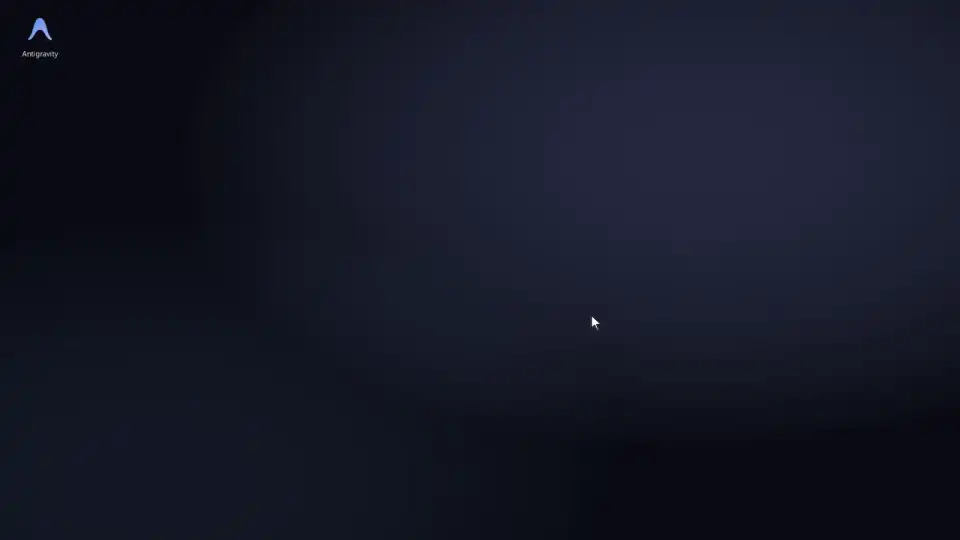
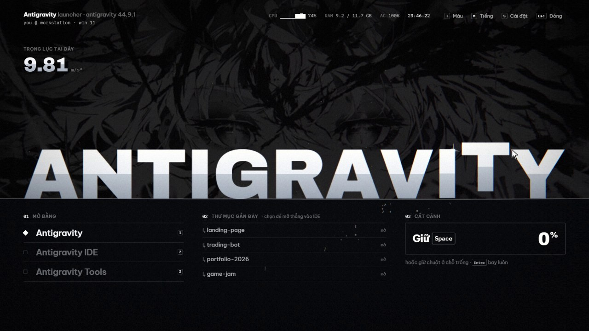
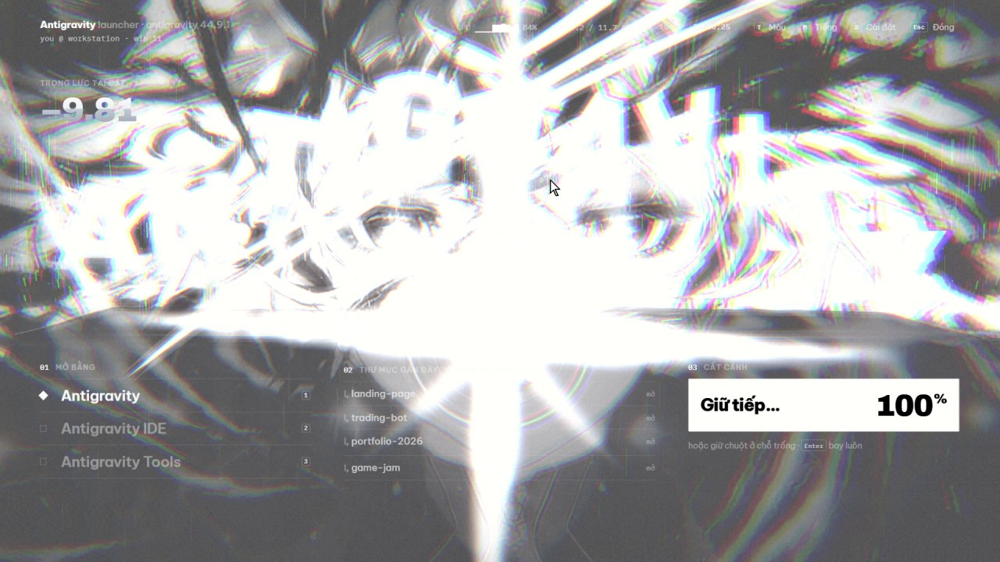
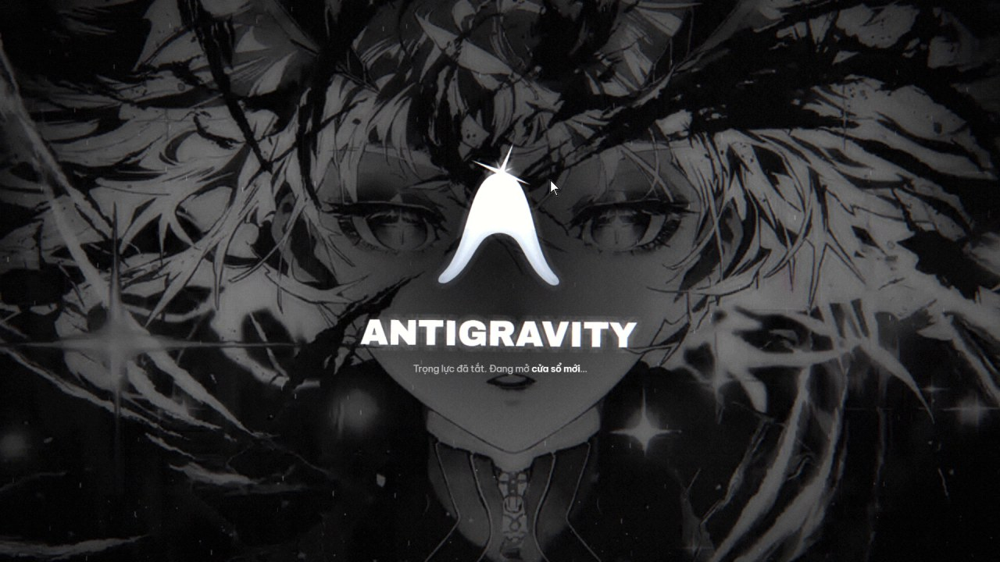
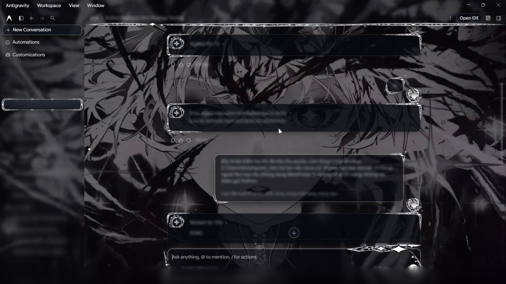

<div align="center">

# Antigravity Liftoff

[Tiếng Việt](README.md) · **English**

[](#install)
[](https://www.python.org/downloads/)
[](LICENSE)

<a href="docs/demo.mp4"></a>

<sub>Click for the sharper MP4. Chat text is blurred for privacy.</sub>

</div>

Antigravity Liftoff replaces the blank window you get when opening Antigravity with a five-second intro: the word ANTIGRAVITY drops onto the screen, you hold `Space` to switch gravity off, the letters launch upward with a bang, and Antigravity opens.

Install it once and keep opening Antigravity the way you always do. Changed your mind? Double-click `uninstall.bat`.

<table>
<tr>
<td></td>
<td></td>
</tr>
<tr>
<td></td>
<td></td>
</tr>
</table>

## Install

You need Windows 10/11, [Python 3.10+](https://www.python.org/downloads/) (tick *Add python.exe to PATH* during setup) and Antigravity itself.

```bash
git clone https://github.com/datphalm/antigravity-liftoff.git
```

Or **Code → Download ZIP** and unzip. Then double-click `install.bat`. It installs two Python packages, backs up your Antigravity shortcuts on the Desktop and in the Start Menu, and points them at the launcher. From then on, open Antigravity the way you always do.

To remove it, double-click `uninstall.bat` and your shortcuts go back to how they were.

To try it without launching the real app:

```bash
python launcher.py --preview --windowed
```

## Controls

| Key | Does |
|---|---|
| hold `Space` or the mouse | Charge antigravity |
| `Enter` | Skip the charge, just go |
| `1` `2` `3`, arrows | Pick Antigravity / IDE / Tools |
| `T` | Change palette |
| `M` | Mute |
| `S` | Settings |
| `Esc` | Close (everything drops to the floor) |

Try clicking one of the letters.

## Configuration

On first run the launcher reads `config.example.json`. Anything you change in Settings (`S`) is saved to `config.json`, which is yours and stays out of git.

| Key | Default | |
|---|---|---|
| `theme` | `silver-ink` | or `crimson-singularity`, `obsidian-prism`, `quantum-cyber`, `solar-eclipse`, `emerald-matrix`, `paper-white` |
| `auth_mode` | `auto` | `auto`, `biometric` (hold a key), `pin` |
| `auto_delay` | `4` | seconds before auto launch |
| `voice` | `en` | `en`, `vi`, `off` |
| `targets.<app>.path` | `%LOCALAPPDATA%\…` | path to the exe |
| `targets.<app>.args` | | extra launch arguments |

Command line: `--target antigravity_ide`, `--preview` (don't launch the app), `--windowed`, and `--demo` (hides your machine name and folders when you record a video to show off).

## The Silver Ink theme inside Antigravity

The chat in the video, with the starlit frames, avatars and the manga girl whose eyes follow your cursor, is [antigravity-silver-ink-theme](https://github.com/wwm100107-creator/antigravity-silver-ink-theme) by another developer. It hooks into Antigravity through the debug port, which is why `config.example.json` launches Antigravity with `--remote-debugging-port=0`. The port is random and local only, but if you don't use the theme, just delete the `args` line.

The theme's Ultra mode looks great and is heavy. I dug into why and patched it in [`extras/silver-ink-perf`](extras/silver-ink-perf): same effects, half the load.

| i3-1215U, Intel UHD, Antigravity fullscreen at 1080p | GPU | CPU |
|---|---|---|
| Original Ultra | 42.9% | 14.8% |
| Patched Ultra | **22.5%** | **7.8%** |

```powershell
powershell -ExecutionPolicy Bypass -File extras\silver-ink-perf\apply.ps1
```

## Under the hood

```
shortcut ──▶ pythonw launcher.py ──▶ fullscreen WebView2 window
                                        ├─ gravity-engine.js   physics + WebGL post FX
                                        ├─ audio-engine.js     Web Audio synthesis
                                        └─ app.js              sequence and UI
               launcher.py ◀─ js_api ──┘  launches the app, focuses it, exits
```

Antigravity starts loading the moment the letters take off, so by the time the logo settles the app is ready. The intro never makes you wait longer than you would anyway.

```
├─ launcher.py
├─ install.bat · uninstall.bat · config.example.json
├─ web/                      UI, engine, audio, artwork
├─ scripts/                  shortcut wiring, silent launch, voice generation
├─ extras/silver-ink-perf/   performance patch for the Silver Ink theme
└─ docs/                     video and screenshots
```

## If something's off

<details>
<summary>Antigravity opens without the intro</summary>

Run `install.bat` again. If you pinned Antigravity to the taskbar earlier, that pin isn't rewired automatically: unpin it and pin it again from the Desktop shortcut.
</details>

<details>
<summary>It says pythonw.exe can't be found</summary>

Install Python from python.org with *Add python.exe to PATH* ticked, then run `install.bat` again.
</details>

<details>
<summary>The lettering looks different from the video</summary>

Fonts come from Google Fonts. Offline, it falls back to Arial Black.
</details>

## Credits

The manga artwork and video come from [antigravity-silver-ink-theme](https://github.com/wwm100107-creator/antigravity-silver-ink-theme); the artwork belongs to its original authors. Voices were generated with Microsoft Edge TTS. Fonts are Archivo Black, Be Vietnam Pro and IBM Plex Mono.

This is a community project made for fun and has nothing to do with Google. "Antigravity" and its logo belong to Google.

Code is [MIT](LICENSE) licensed.
