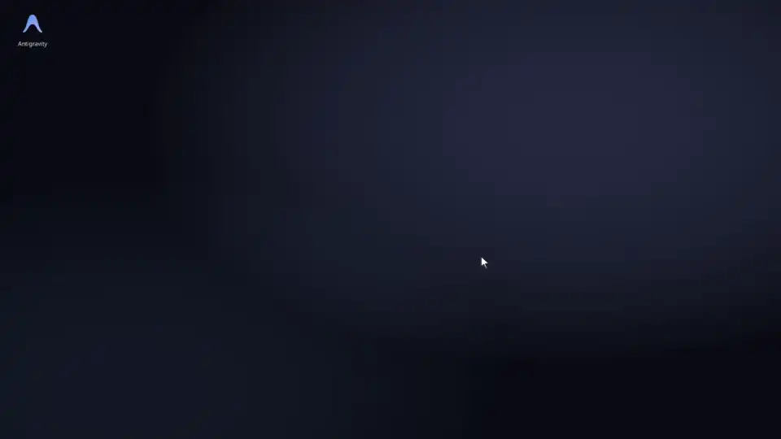
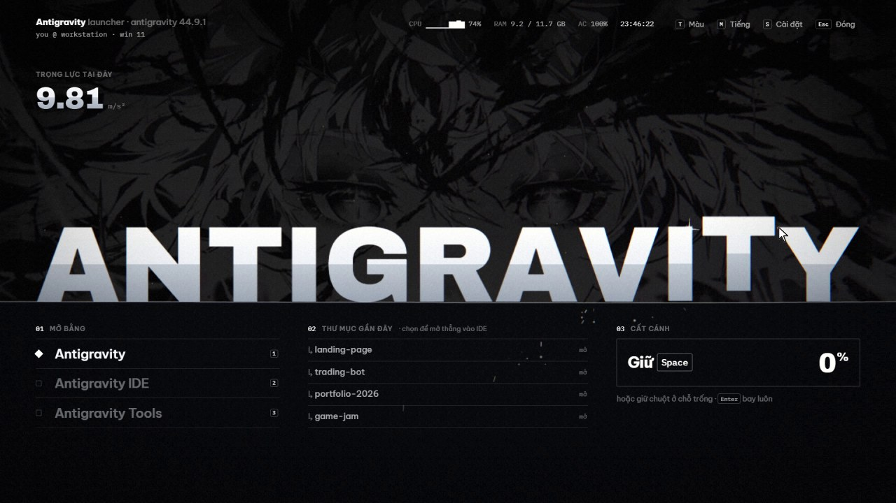
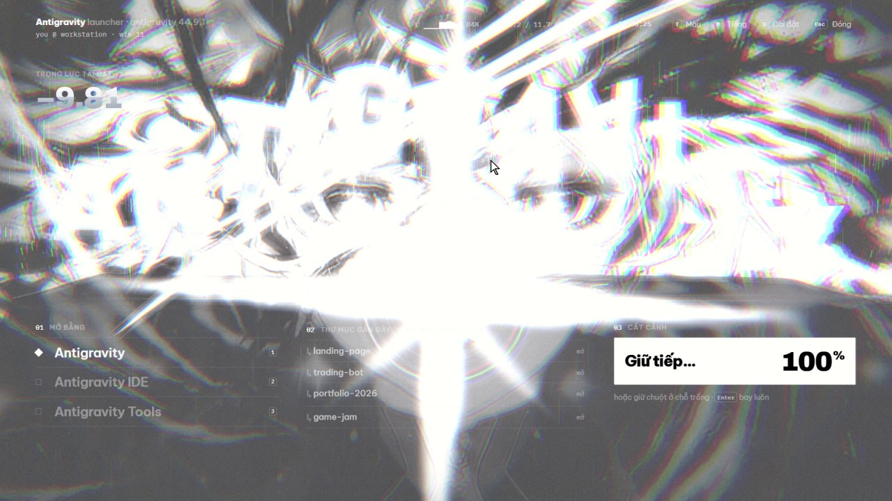
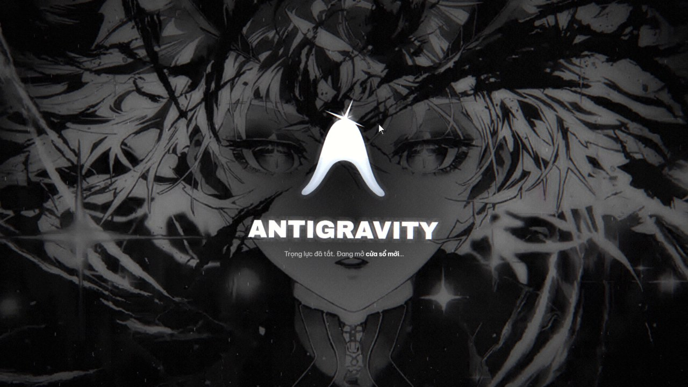
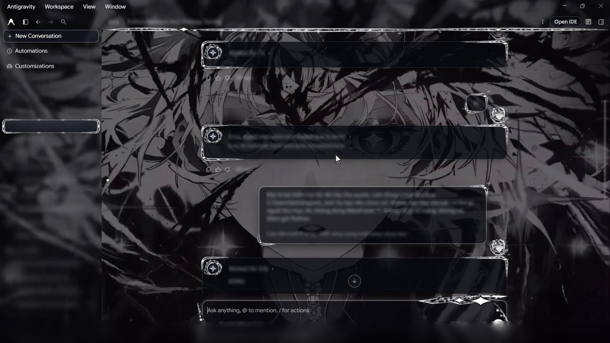

<div align="center">

# Antigravity Liftoff

**Tiếng Việt** · [English](README.en.md)

[](#cài-đặt)
[](https://www.python.org/downloads/)
[](LICENSE)

<a href="docs/demo.mp4"></a>

<sub>Bấm vào để xem bản MP4 nét hơn. Chữ trong khung chat được làm mờ cho riêng tư.</sub>

</div>

Antigravity Liftoff thay cái màn hình trống lúc mở Antigravity bằng một đoạn intro khoảng 5 giây: chữ ANTIGRAVITY rơi xuống, bạn giữ `Space` để tắt trọng lực, chữ bay lên kèm một cú nổ, rồi Antigravity mở ra.

Cài một lần là xong, sau đó cứ mở Antigravity như bình thường. Không thích nữa thì nháy đúp `uninstall.bat` là gỡ.

<table>
<tr>
<td></td>
<td></td>
</tr>
<tr>
<td></td>
<td></td>
</tr>
</table>

## Cài đặt

Cần Windows 10/11, [Python 3.10+](https://www.python.org/downloads/) (lúc cài nhớ tick *Add python.exe to PATH*) và tất nhiên là Antigravity.

```bash
git clone https://github.com/datphalm/antigravity-liftoff.git
```

Hoặc bấm **Code → Download ZIP** rồi giải nén. Sau đó nháy đúp `install.bat`. Nó cài hai thư viện Python, sao lưu shortcut Antigravity trên Desktop và Start Menu, rồi trỏ chúng qua launcher. Từ giờ cứ mở Antigravity như mọi khi.

Muốn gỡ thì nháy đúp `uninstall.bat`, shortcut được trả về nguyên trạng.

Muốn xem thử mà không mở app thật:

```bash
python launcher.py --preview --windowed
```

## Phím tắt

| Phím | Làm gì |
|---|---|
| giữ `Space` hoặc giữ chuột | Nạp phản trọng lực |
| `Enter` | Bay luôn, khỏi nạp |
| `1` `2` `3`, mũi tên | Chọn Antigravity / IDE / Tools |
| `T` | Đổi màu |
| `M` | Tắt / bật tiếng |
| `S` | Cài đặt |
| `Esc` | Đóng (mọi thứ rơi xuống đất) |

Thử bấm vào một chữ cái xem.

## Tuỳ chỉnh

Lần đầu chạy, launcher đọc `config.example.json`. Bạn đổi gì trong phần Cài đặt (phím `S`) thì nó lưu vào `config.json`, file này của riêng bạn và không bị đưa lên git.

| Khoá | Mặc định | |
|---|---|---|
| `theme` | `silver-ink` | hoặc `crimson-singularity`, `obsidian-prism`, `quantum-cyber`, `solar-eclipse`, `emerald-matrix`, `paper-white` |
| `auth_mode` | `auto` | `auto`, `biometric` (giữ phím), `pin` |
| `auto_delay` | `4` | số giây chờ trước khi tự mở |
| `voice` | `en` | `en`, `vi`, `off` |
| `targets.<app>.path` | `%LOCALAPPDATA%\…` | đường dẫn tới file exe |
| `targets.<app>.args` | | tham số thêm khi mở app |

Dòng lệnh có `--target antigravity_ide`, `--preview` (không mở app), `--windowed`, và `--demo` (giấu tên máy, tên thư mục khi quay video khoe bạn bè).

## Theme Silver Ink trong Antigravity

theme [antigravity-silver-ink-theme](https://github.com/wwm100107-creator/antigravity-silver-ink-theme) của một bạn khác. Theme gắn vào Antigravity qua cổng debug, nên `config.example.json` đã bật sẵn `--remote-debugging-port=0` khi mở Antigravity. Cổng là ngẫu nhiên và chỉ mở trong máy, nhưng nếu không dùng theme thì xoá dòng `args` đi cho gọn.

Bản Ultra của theme đẹp nhưng nặng. Mình đã đào vào xem vì sao rồi vá lại trong [`extras/silver-ink-perf`](extras/silver-ink-perf), hiệu ứng giữ nguyên mà tải giảm một nửa:

| i3-1215U, Intel UHD, Antigravity toàn màn hình 1080p | GPU | CPU |
|---|---|---|
| Ultra gốc | 42.9% | 14.8% |
| Ultra đã vá | **22.5%** | **7.8%** |

```powershell
powershell -ExecutionPolicy Bypass -File extras\silver-ink-perf\apply.ps1
```

## Bên trong

```
shortcut ──▶ pythonw launcher.py ──▶ cửa sổ WebView2 toàn màn hình
                                        ├─ gravity-engine.js   vật lý + hậu kỳ WebGL
                                        ├─ audio-engine.js     âm thanh Web Audio
                                        └─ app.js              kịch bản, giao diện
               launcher.py ◀─ js_api ──┘  mở app, focus cửa sổ, tự thoát
```

Antigravity được mở ngay lúc chữ bay lên, nên khi logo hiện xong thì app cũng vừa tải xong. Intro không làm bạn chờ thêm giây nào.

```
├─ launcher.py
├─ install.bat · uninstall.bat · config.example.json
├─ web/                      giao diện, engine, âm thanh, tranh nền
├─ scripts/                  gắn shortcut, chạy ẩn, tạo giọng đọc
├─ extras/silver-ink-perf/   bản vá hiệu năng cho theme Silver Ink
└─ docs/                     video và ảnh
```

## Lỡ có trục trặc

<details>
<summary>Mở Antigravity mà không thấy intro</summary>

Chạy lại `install.bat`. Nếu bạn ghim Antigravity lên taskbar từ trước thì cái ghim đó không được gắn tự động: bỏ ghim, rồi ghim lại từ shortcut ngoài Desktop.
</details>

<details>
<summary>Báo không tìm thấy pythonw.exe</summary>

Cài Python từ python.org, tick *Add python.exe to PATH*, rồi chạy lại `install.bat`.
</details>

<details>
<summary>Chữ trông khác trong video</summary>

Font được tải từ Google Fonts. Không có mạng thì nó dùng tạm Arial Black.
</details>

## Ghi công

Tranh và video manga lấy từ theme [antigravity-silver-ink-theme](https://github.com/wwm100107-creator/antigravity-silver-ink-theme), quyền với tác phẩm thuộc về tác giả gốc. Giọng đọc tạo bằng Microsoft Edge TTS. Font là Archivo Black, Be Vietnam Pro và IBM Plex Mono.

Đây là dự án làm cho vui của cộng đồng, không liên quan gì tới Google. "Antigravity" và logo là của Google.

Mã nguồn theo giấy phép [MIT](LICENSE).
